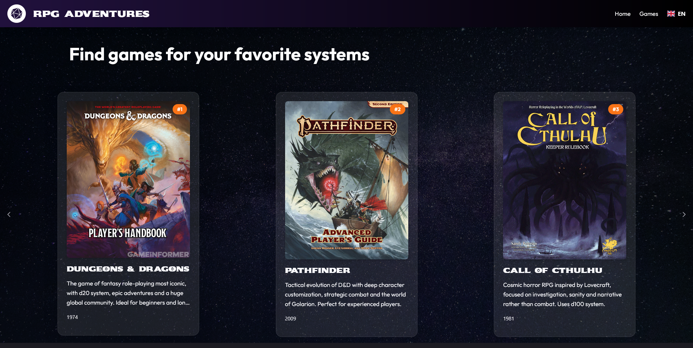

# RPG-Adventures — Tabletop RPG Campaign Platform

Single-page web application for tabletop role-playing game (TTRPG) communities to browse open campaigns, publish new adventures, and manage player registrations.

Live Demo: **[v-pelaez.github.io/RPG-Adventures](https://v-pelaez.github.io/RPG-Adventures/)**



## Key Features

- **Interactive Campaign Directory:** PrimeVue `DataTable` supporting expandable rows, real-time keyword filtering, and column sorting.
- **Forms & Client-Side Validation:** Modal player registration form (`PlayerFormComponent.vue`) with regex validation and a dynamic campaign publishing form validated with Vuelidate.
- **Data Visualization:** Dynamic Chart.js visualizations (bar, doughnut, and pie charts) with automatic grouping of minor categories into an `"Others"` bucket.
- **Internationalization (i18n):** Multi-language support built with Vue I18n featuring automatic browser language detection, English fallback, and a header language switcher.
- **Asynchronous JSON Data Loading:** Client-side loading of structured JSON datasets powering a featured games carousel and a popular TTRPG systems overview.
- **Responsive & Accessible UI:** Adaptive layout for desktop and mobile devices with text descriptions for images and charts.

## Architecture Highlights

- **Modular Composition API:** Statistics aggregation, translation helpers, and UI logic are decoupled into dedicated Vue 3 composables and reusable components.
- **Centralized TypeScript Modeling:** Shared interfaces are centralized in `types.ts` to maintain consistency across JSON datasets and components, verified at build time via `vue-tsc`.

## Tech Stack

- **Framework & Build:** Vue 3 (`^3.5.24`) · Vue Router 4 (`^4.6.4`) · Vite 7 (`^7.2.4`)
- **Language & Type Checking:** TypeScript (`~5.9.3`) · `vue-tsc`
- **UI & Styling:** PrimeVue 4 (`^4.5.4`) · PrimeIcons · Tailwind CSS 3 (`^3.4.19`) · PostCSS
- **Validation, i18n & Charts:** Vuelidate · Vue I18n 11 · Chart.js 4

## Local Development

### Setup

```bash
git clone [https://github.com/v-pelaez/RPG-Adventures.git](https://github.com/v-pelaez/RPG-Adventures.git)
cd RPG-Adventures
npm install
```

### Scripts

| Command | Description |
| :--- | :--- |
| `npm run dev` | Start the Vite development server |
| `npm run build` | Run TypeScript checking (`vue-tsc -b`) and build for production |
| `npm run preview` | Locally preview the production build |
